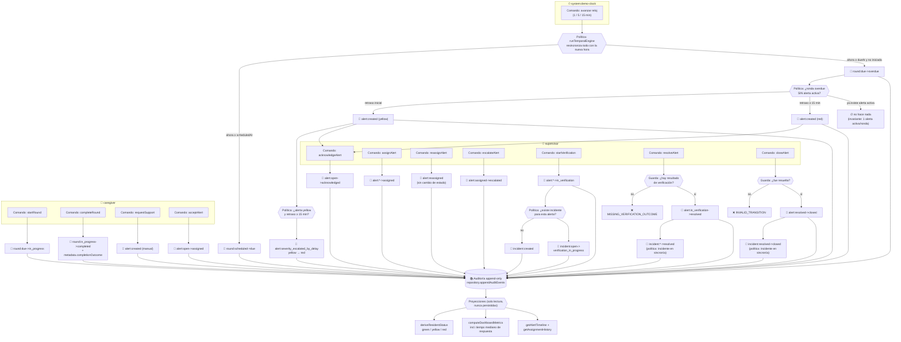

# 06 — Mapa event-driven — CareSignal MVP v0.1.0-workshop

> **Nota de alcance:** el contrato congelado (§9.2) enumera `docs/00`–`05`. Este
> documento `06` es **documentación derivada añadida después del Gate C8**: describe
> el comportamiento ya implementado y verificado, y **no introduce** entidades,
> estados, transiciones ni actores nuevos. Si algo aquí contradijera el contrato,
> `docs/01-domain-taxonomy.yaml` y `docs/02-state-machine.md` mandan.
>
> Todos los eventos listados se extrajeron del código real (`src/domain/transitions.ts`,
> `src/features/**/*Operations.ts`, `src/data/temporalEngine.ts`, `src/data/seed.ts`),
> no de un diseño teórico.

## 1. Por qué este mapa existe

CareSignal ya es, de hecho, un sistema orientado a eventos: **toda acción material
emite un `AuditEvent`** (contrato §6.4, §6.17) y ese registro es append-only
(§6.18). Este documento hace explícito ese modelo implícito: qué comando dispara qué
evento, qué política reacciona automáticamente, y qué invariantes protegen el flujo.

## 2. Leyenda

| Símbolo | Significado |
|---|---|
| **Actor** | Quien inicia: `caregiver`, `supervisor`, o el sistema (`system:demo-clock`, `system:seed`) |
| **Comando** | Intención explícita (función en `features/**/*Operations.ts`) |
| **Evento** | Hecho consumado y registrado en la auditoría (`AuditEvent.action`) |
| **Política** | Reacción automática: "cuando ocurre X, entonces Y" |
| **Agregado** | Entidad dueña de su consistencia: `Round`, `Alert`, `Incident` |

## 3. Catálogo de eventos (los realmente emitidos)

### 3.1 Eventos de ciclo de vida del agregado `Round`

| Evento (`action`) | Emitido por | Actor típico |
|---|---|---|
| `round:created` | `seed.ts` | `system:seed` |
| `round:scheduled->due` | `temporalEngine.ts` | `system:demo-clock` |
| `round:due->overdue` | `temporalEngine.ts` | `system:demo-clock` |
| `round:due->in_progress` | `roundOperations.startRound` | `caregiver` |
| `round:in_progress->completed` | `roundOperations.completeRound` | `caregiver` |
| `round:scheduled->cancelled` / `round:due->cancelled` | `transitionRound` — **sin comando de UI en v0.1.0**; solo lo ejercita `seed.ts` | `supervisor` (en la semilla, `staff-supervisor-01`) |

> `round:in_progress->completed` lleva el resultado operacional en
> `AuditEvent.metadata.completionOutcome` (`completed_without_issue`,
> `assistance_requested`, `supervisor_verification_required`) — el modelo congelado
> §8.3 no tiene un campo propio para ello (ver `docs/03-data-model.md`, decisión 6).

### 3.2 Eventos del agregado `Alert`

| Evento (`action`) | Emitido por | Actor típico |
|---|---|---|
| `alert:created` | `temporalEngine.ts` (por vencimiento) · `roundOperations.requestSupport` (manual) | `system:demo-clock` · `caregiver` |
| `alert:severity_escalated_by_delay` | `temporalEngine.ts` | `system:demo-clock` |
| `alert:open->acknowledged` | `alertOperations.acknowledgeAlert` | `supervisor` |
| `alert:open->assigned` / `alert:acknowledged->assigned` | `alertOperations.assignAlert` · `roundOperations.acceptAlert` | `supervisor` · `caregiver` |
| `alert:reassigned` | `alertOperations.reassignAlert` | `supervisor` |
| `alert:assigned->escalated` | `alertOperations.escalateAlert` | `supervisor` |
| `alert:assigned->in_verification` / `alert:escalated->in_verification` | `alertOperations.startVerification` | `supervisor` |
| `alert:in_verification->resolved` | `alertOperations.resolveAlert` | `supervisor` |
| `alert:resolved->closed` | `alertOperations.closeAlert` | `supervisor` |

> **`alert:reassigned` es el único evento de alerta que no corresponde a una
> transición de estado.** Reasignar no mueve la alerta de `assigned`/`escalated`, así
> que no está en la lista blanca de `ALERT_TRANSITIONS`; se registra a mano para
> cumplir la regla "toda reasignación genera auditoría" (contrato §Chunk 6). Guarda
> el responsable anterior y el nuevo en `previousState`/`nextState`.

### 3.3 Eventos del agregado `Incident`

| Evento (`action`) | Emitido por | Actor típico |
|---|---|---|
| `incident:created` | `alertOperations.startVerification` · `seed.ts` | `supervisor` |
| `incident:open->verification_in_progress` | `alertOperations.startVerification` | `supervisor` |
| `incident:verification_in_progress->resolved` | `alertOperations.resolveAlert` | `supervisor` |
| `incident:resolved->closed` | `alertOperations.closeAlert` | `supervisor` |

### 3.4 Eventos de alta de catálogo (solo semilla)

`resident:created`, `staff_member:created` — emitidos por `seed.ts` con actor
`system:seed`. No hay comandos de UI para crearlos: el catálogo es fijo en el MVP.

## 4. Mapa del flujo principal

## 5. Políticas (reacciones automáticas)

| # | Cuando ocurre… | …entonces | Dónde vive |
|---|---|---|---|
| P1 | Se avanza o restablece el reloj | Se ejecuta el motor temporal completo | `demoClock.ts` → `temporalEngine.ts` |
| P2 | `ahora ≥ scheduledAt` en ronda `scheduled` | `round:scheduled->due` | `temporalEngine.ts` |
| P3 | `ahora ≥ dueAt` en ronda `due` | `round:due->overdue` | `temporalEngine.ts` |
| P4 | Ronda `overdue` **sin** alerta activa | `alert:created` (yellow, o red si retraso ≥ 15 min) | `temporalEngine.ts` |
| P5 | Alerta `yellow` activa y retraso ≥ `CRITICAL_DELAY_MINUTES` (15) | `alert:severity_escalated_by_delay` | `temporalEngine.ts` |
| P6 | Se inicia verificación y no hay incidente | `incident:created` + pasa a `verification_in_progress` | `alertOperations.startVerification` |
| P7 | Se resuelve la alerta | El incidente asociado también se resuelve, con el mismo resultado | `alertOperations.resolveAlert` |
| P8 | Se cierra la alerta | El incidente resuelto también se cierra | `alertOperations.closeAlert` |

**Política ausente a propósito:** al corregirse el origen (p. ej. se atiende la
ronda), la alerta **no** se cierra sola — requiere verificación humana (contrato
Chunk 7). No existe ninguna política que resuelva o cierre alertas automáticamente.

## 6. Invariantes que el mapa debe respetar

| Invariante | Dónde se hace cumplir |
|---|---|
| Máximo **una alerta activa por ronda** | `hasActiveAlertForRound` — usado por el motor temporal y por `requestSupport` |
| **No resolver sin resultado** de verificación | `transitionAlert` → `MISSING_VERIFICATION_OUTCOME` |
| **No cerrar sin resolver** | Lista blanca `ALERT_TRANSITIONS` (único origen: `resolved`) |
| Ronda `completed`/`cancelled` **nunca vence** ni genera alerta | `isRoundTerminal`, respetado por el motor temporal |
| Toda transición registra **actor + fecha/hora** | `TransitionContext` obligatorio en las tres funciones de transición |
| Auditoría **append-only**, no editable desde la UI | `repository.appendAuditEvents` solo concatena |
| El color del residente **nunca se persiste** | `deriveResidentStatus` es pura y se recalcula en cada render |
| Ejecutar el motor temporal N veces = ejecutarlo una vez | Idempotencia verificada en `tests/temporal-engine.test.ts` |

## 7. Proyecciones (lado de lectura)

Ninguna se persiste; todas se derivan en el momento a partir del estado + la auditoría:

- **`deriveResidentStatus(residentId, rounds, alerts)`** → `green` / `yellow` / `red`.
- **`computeDashboardMetrics(...)`** → las 10 métricas del dashboard. El *tiempo
  mediano de respuesta* se calcula **leyendo la auditoría** (primer evento de la
  alerta distinto de su creación), precisamente porque `Alert` no tiene un campo
  `assignedAt` — es el caso más claro de proyección event-driven del MVP.
- **`getAlertTimeline(alertId, incidentId, auditEvents)`** → línea de tiempo unificada
  de alerta + incidente.
- **`getAssignmentHistory(alertId, auditEvents)`** → historial de responsables,
  reconstruido de `alert:reassigned` y de los eventos con `nextState = assigned`.

## 8. Limitaciones del modelo actual (honestas)

- **No hay bus de eventos ni suscriptores.** Los "eventos" se escriben en la auditoría
  de forma síncrona; las políticas son llamadas directas dentro de la misma función.
  Es un modelo *event-sourced en la auditoría*, no una arquitectura pub/sub.
- **La auditoría no es la fuente de verdad del estado.** El estado vive en las
  entidades (`Round`, `Alert`, `Incident`) y la auditoría lo acompaña. Un event
  sourcing real reconstruiría el estado reproduciendo los eventos; aquí no se hace.
- **`round:*->cancelled` no tiene comando de UI** en v0.1.0: la transición existe y
  está permitida, pero solo la ejercita la semilla.
- Migrar a un bus real, o a event sourcing como fuente de verdad, sería un cambio de
  arquitectura que requiere **solicitud formal de cambio** y nueva versión del
  contrato (§13). Registrado como candidato de Backlog v0.2.
