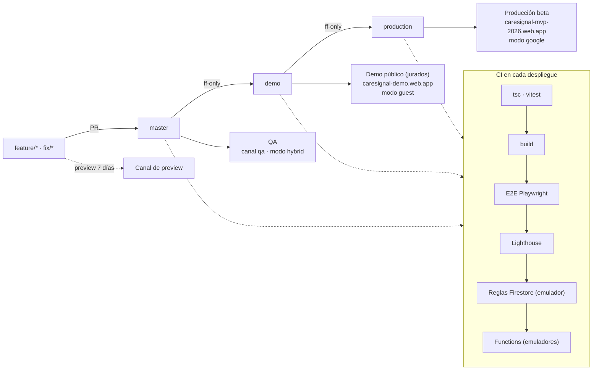
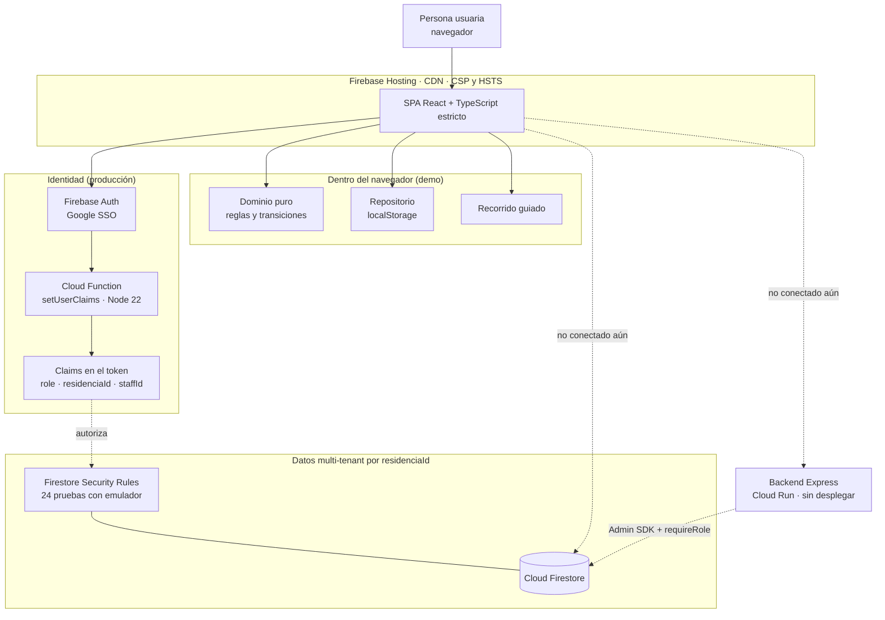
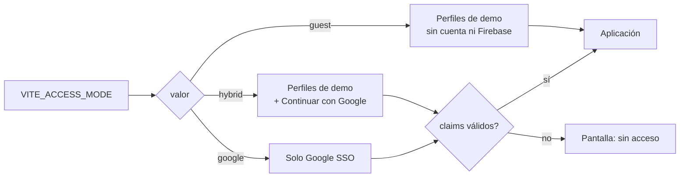

# Arquitectura de CareSignal (estado real, 2026-10-16)

> Diagramas en Mermaid: GitHub los dibuja directamente en este archivo.
> Lo que existe, lo que está conectado y lo que **no** lo está se distingue a propósito:
> el MVP es una demo operacional con datos ficticios, no un dispositivo médico.

## 1. Entornos y flujo de despliegue

Tres ramas permanentes; `demo` y `production` solo avanzan por *fast-forward* desde la anterior.
Ningún despliegue corre sin que el CI esté en verde sobre el mismo commit.

| Entorno | Rama | Acceso | Datos |
|---|---|---|---|
| Demo público | `demo` | Solo invitado (3 perfiles), recorrido guiado | Ficticios, solo `localStorage` del navegador |
| QA | `master` | Invitado y Google | Ficticios |
| Producción (beta) | `production` | Solo Google, con claims | Firestore real (aún no conectado a la interfaz) |

## 2. Arquitectura en ejecución

Línea continua = existe y está conectado. Línea punteada = existe en el repositorio pero **no** está conectado
a la interfaz todavía.

### Qué está conectado hoy
- **Demo (guest):** la app corre completa en el navegador; el estado vive en `localStorage` a través de una única capa de repositorio.
- **Producción (google):** el inicio de sesión con Google es real, y los claims los pone `setUserClaims` al crear la cuenta (o `scripts/set-user-claims.mjs` para cuentas existentes). Una cuenta sin claims ve "sin acceso".
- **Seguridad:** CSP en modo bloqueo, HSTS, `X-Frame-Options: DENY`, `Permissions-Policy`; Security Rules con aislamiento por `residenciaId` y roles.

### Qué NO está conectado (para no sobrevender)
- La interfaz no lee ni escribe en Firestore: los datos que ve una cuenta de producción siguen siendo los de demostración en `localStorage`.
- `backend/` (Express para Cloud Run) existe pero no está desplegado.
- El rol de la interfaz sale del selector "Usuario ficticio", no del token (identidad unificada pendiente).

## 3. Modos de acceso

Una sola variable (`VITE_ACCESS_MODE`) cambia cómo entra una persona, sin tocar guardias ni páginas.

Sin la variable: `google` si hay configuración de Firebase, `guest` si no.

## 4. Documentos relacionados

| Tema | Archivo |
|---|---|
| Contrato de ramas y CI/CD | `docs/20-contrato-ramas-cicd.md` |
| Cuentas de servicio, roles y APIs de Google Cloud | `docs/21-gcp-iam-apis-deploy.md` |
| Benchmark de ingeniería y brechas | `docs/18-benchmark-ingenieria.md` |
| Plan de acciones E7 | `docs/19-contrato-acciones-benchmark.md` |
| Máquina de estados y taxonomía | `docs/02-state-machine.md`, `docs/01-domain-taxonomy.yaml` |
